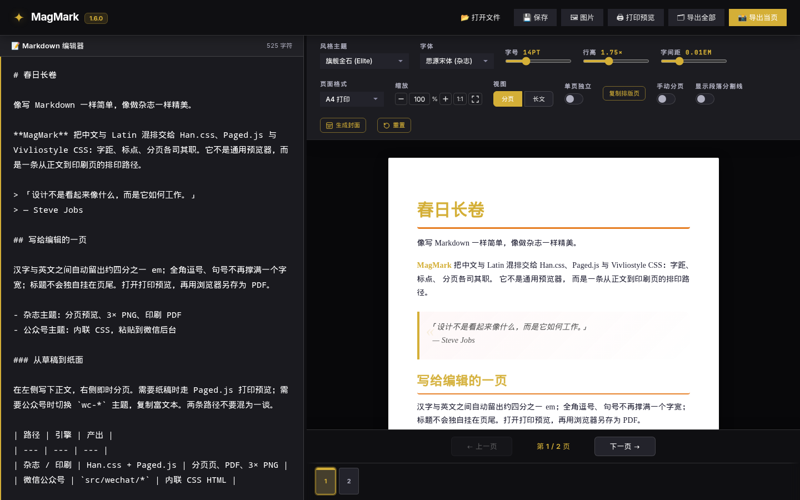
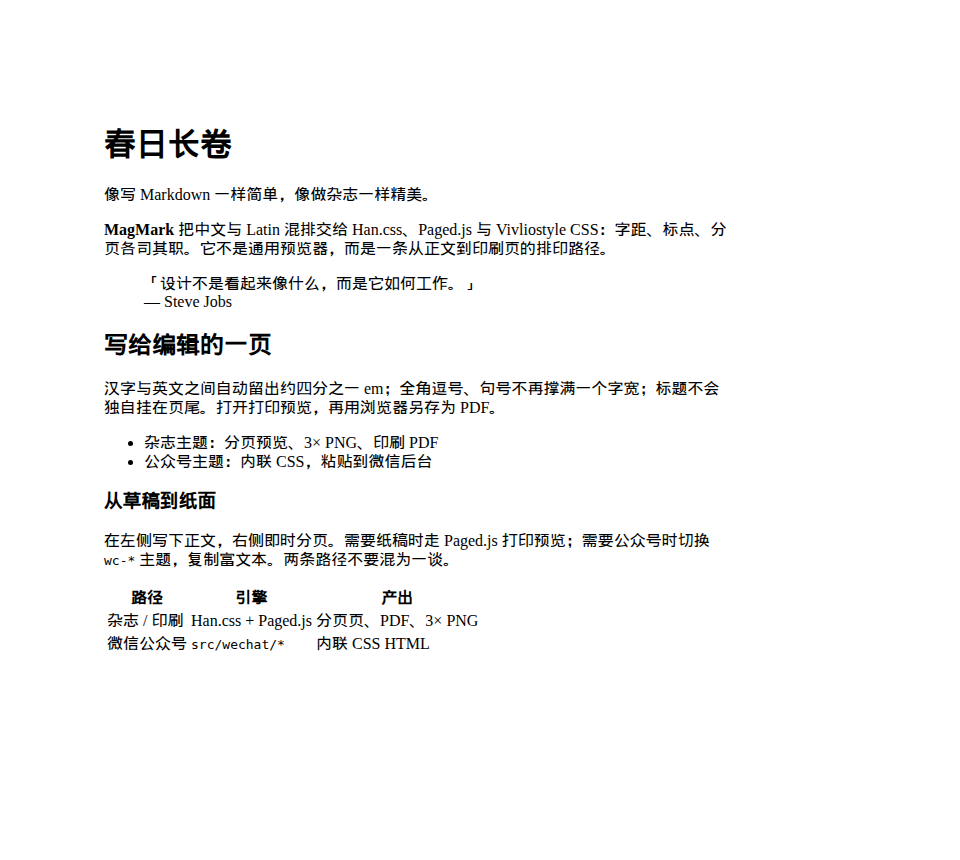
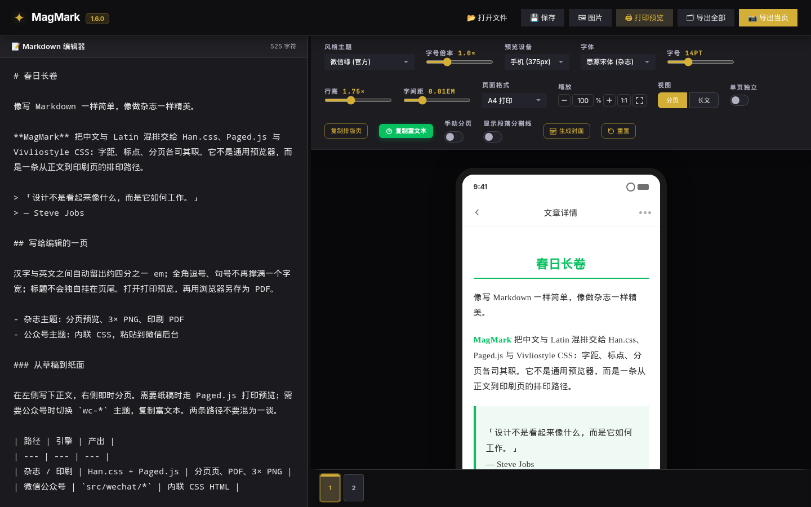

<p align="center"><picture><source media="(prefers-color-scheme: dark)" srcset="public/brand/magmark-monochrome-dark.svg"><source media="(prefers-color-scheme: light)" srcset="public/brand/magmark-monochrome.svg"></picture></p>
<h1 align="center">MagMark</h1>
<p align="center"><strong>Markdown → Chinese magazine layout / export</strong></p>
<p align="center">Write in Markdown. Shape it into a magazine.</p>
<p align="center"><a href="README.md">简体中文</a> · <a href="README.zh-Hant.md">繁體中文</a> · English · <a href="README.ja.md">日本語</a> · <a href="README.ko.md">한국어</a></p>
<p align="center"><a href="https://magmark.cn/"><strong>Try it online at magmark.cn</strong></a></p>

<p align="center"></p>
<p align="center"><em>Current MagMark 2 workspace (comparison view): Markdown on the left, a paginated Chinese magazine page on the right.</em></p>

| Magazine / print preview | WeChat paste preview |
| :---: | :---: |
|  |  |
| Paginated print output. This capture is from an earlier print-preview window: the page still represents the magazine / print path, but the editor chrome may differ from MagMark 2. | Screenshot of the **1.6.0** editor (version visible in the header). MagMark 2 still copies WeChat-compatible rich text, but the toolbar, panels and preview chrome have changed. |

MagMark is a Markdown editing, typesetting and export workspace for Chinese and mixed Chinese–English writing. Keep the source editable, inspect the layout, and take the same article to paginated pages, PNG, browser-printed PDF or WeChat-compatible rich text.

> **2.0.0-beta.1 is on `main`** and available at [magmark.cn](https://magmark.cn/). This is still a beta: other browsers, real OS Chinese IME, mobile WebViews, and whether WeChat keeps images and styles after paste-and-save still need acceptance in the target environment. Keep separate Markdown backups. MagMark is not document hosting, real-time collaboration, or automated publishing, and it will not log in or publish to WeChat for you.

## Run the beta

Use Node.js 22 to match repository CI:

```bash
git clone --branch main --single-branch https://github.com/jammyfu/MagMark.git
cd MagMark
npm ci
npm run dev
```

Open the address printed by Vite, using your assigned workspace port. Import or paste Markdown, switch between writing / comparison / preview, adjust the article in the typography inspector, then open the export dialog.

## What is available

CodeMirror source editing with undo / redo; three workspace views and a draggable split; independent light / dark workspace appearance; article themes, typography controls and paginated / continuous views; local image-directory linking, captions, alignment and width; local autosave and bounded history; multi-format cover templates and PNG export.

Supported preview text can be double-clicked for source-aware editing. Ambiguous or stale mappings are rejected rather than guessed. The Folio brand and locally bundled Lucide SVG icons identify the workspace and its actual controls without becoming article content.

## Outputs

**Magazine / print:** Han.css, Paged.js and CSS pagination rules support the print path. Use the print-preview action and your browser's Save as PDF command. PNG output supports the current page or all pages at 3× sampling. Overflow and pending-preview guards can prevent unsafe output.

**WeChat:** a separate renderer produces sanitized inline-style HTML. It does not run the magazine Han.css / Paged.js pipeline. Copy into WeChat and verify images and formatting after saving there. MagMark does not log in or publish for you. Rich-text copying to other editors is also available; fidelity depends on the destination.

## Limits and privacy

This is not cloud storage, collaborative editing, a document-hosting platform or an automated publishing service. Browser history is not a backup and does not capture every layout or cover-session setting. Complex pagination, slow resources, real OS IME, other browser engines and real-platform paste/save round trips still need acceptance testing.

Local-first does not mean fully offline: the entry loads external fonts and Han.css, and remote images make network requests. Optional AI generation uses the configured provider; API-key preferences may remain in browser storage. Do not store keys on untrusted shared devices.

Experimental SDK, Typst and PrinceXML code is not a promise of available production exporters. See [export capabilities](docs/project-governance/SDK_EXPORT_CAPABILITIES.md), [current plan](CURRENT_PLAN.md) and the [detailed Chinese guide](README.md).

## Development

Vite + TypeScript, CodeMirror, unified / remark / rehype, separate magazine and WeChat rendering paths. Run `npm run typecheck`, `npm test`, `npm run build` and `python3 tools/verify.py`. Browser regressions have separate dependencies and commands; see [TESTING_GUIDE.md](TESTING_GUIDE.md).

For a useful bug report, include minimal Markdown, browser version, theme, page format, reproduction steps and expected output.

## Author and license

Created and maintained by **[jammyfu](https://github.com/jammyfu)**. MagMark code is [MIT licensed](LICENSE). Lucide / Feather icon notices are preserved in [LUCIDE-LICENSE.txt](public/brand/LUCIDE-LICENSE.txt). See [brand and icon mapping](docs/brand/README.md).
