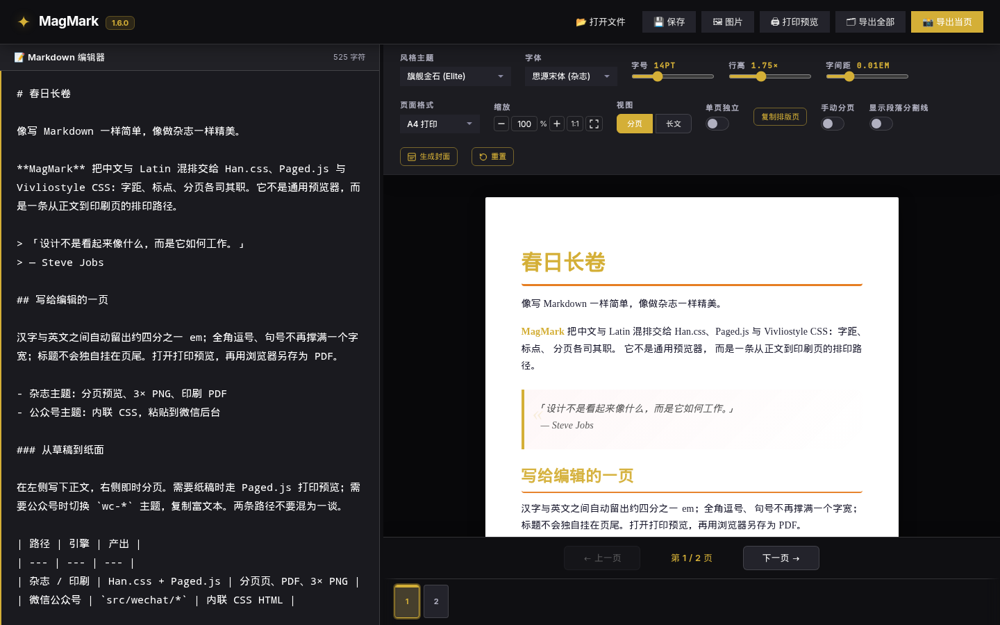
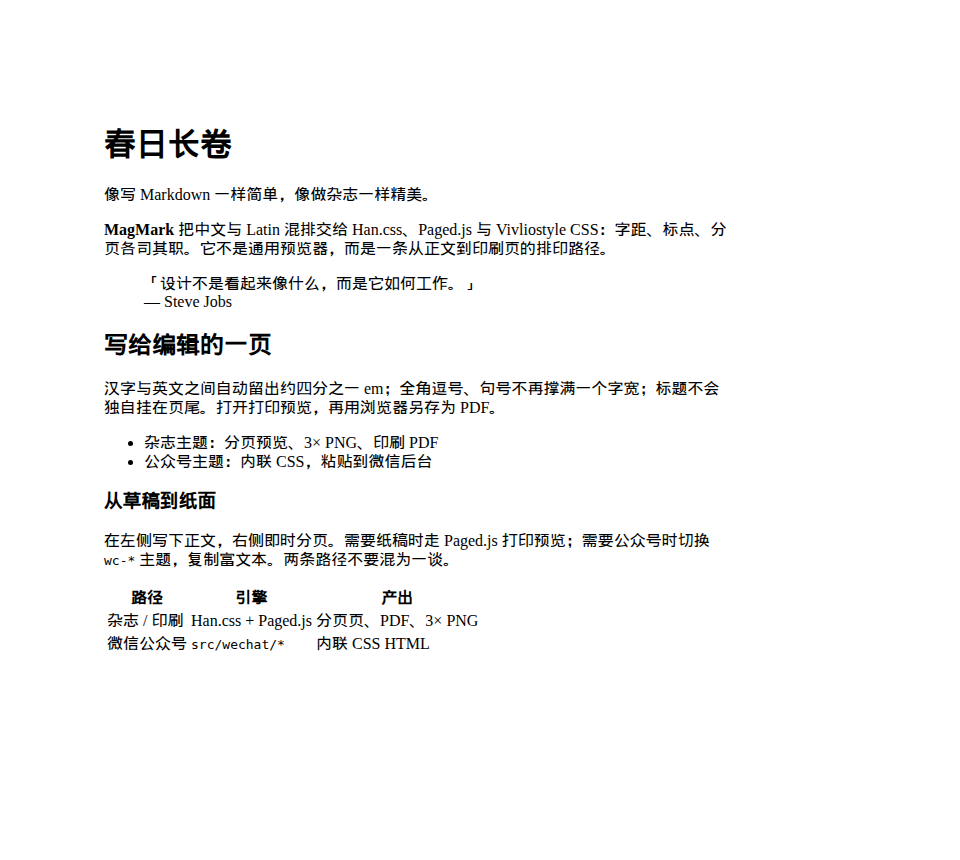
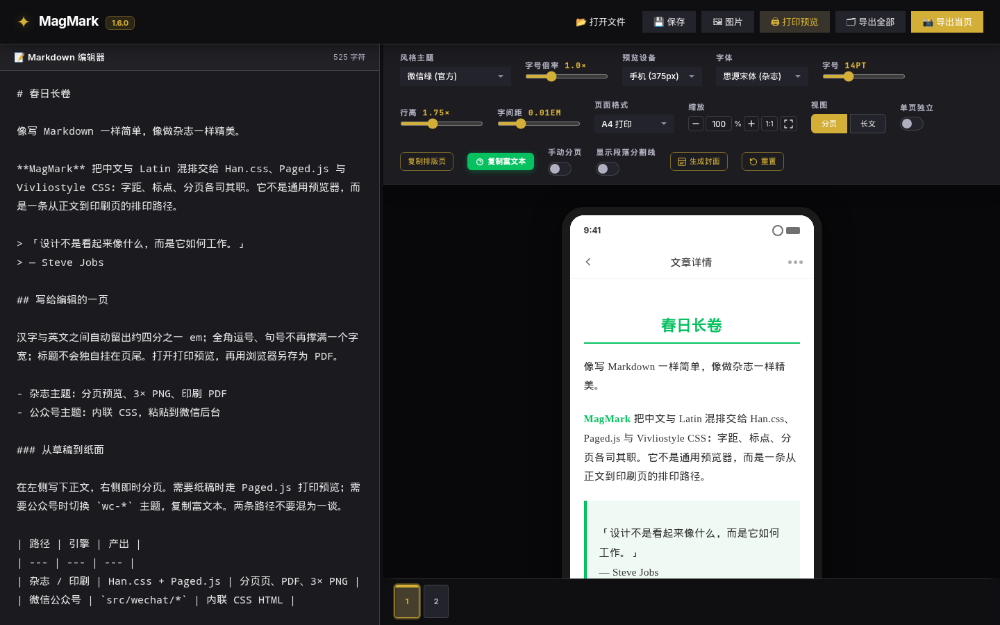

<p align="center"><picture><source media="(prefers-color-scheme: dark)" srcset="public/brand/magmark-monochrome-dark.svg"><source media="(prefers-color-scheme: light)" srcset="public/brand/magmark-monochrome.svg"></picture></p>

<h1 align="center">MagMark</h1>
<p align="center"><strong>Markdown을 중국어 잡지형 지면으로 편집하고 내보내세요.</strong></p>
<p align="center"><a href="README.md">简体中文</a> · <a href="README.zh-Hant.md">繁體中文</a> · <a href="README.en.md">English</a> · <a href="README.ja.md">日本語</a> · 한국어</p>
<p align="center"><a href="https://magmark.cn/"><strong>magmark.cn에서 직접 사용하기</strong></a></p>

<p align="center"></p>
<p align="center"><em>현재 MagMark 2 작업 화면입니다. 원문을 편집하면서 페이지 구성을 확인할 수 있습니다.</em></p>

| 잡지 / 인쇄 미리보기 | WeChat 붙여넣기 미리보기 |
| :---: | :---: |
|  |  |
| 이전 인쇄 미리보기 창의 화면입니다. 지면은 잡지·인쇄 경로를 보여주지만 편집기 외형은 MagMark 2와 다를 수 있습니다. | 상단에 버전이 보이는 **1.6.0** 화면입니다. MagMark 2도 WeChat용 서식 있는 텍스트를 복사하지만 도구 모음, 패널과 미리보기 외형은 달라졌습니다. |

MagMark는 중국어와 중국어·영어 혼용 글을 위한 Markdown 편집·조판·내보내기 도구입니다. 원문을 편집 가능한 형태로 보관하고 지면을 확인한 뒤, 같은 글을 페이지, PNG, 브라우저 인쇄 PDF 또는 WeChat용 서식 있는 텍스트로 활용합니다.

> **2.0.0-beta.1이 main에 있으며 [magmark.cn](https://magmark.cn/)에서 사용할 수 있습니다.** 아직 베타입니다. 다른 브라우저, 실제 OS 중국어 입력기, 모바일 WebView, WeChat에 붙여넣고 저장한 뒤 이미지와 서식이 유지되는지는 대상 환경에서 확인해야 합니다. 중요한 Markdown 원문은 별도로 백업하세요. 문서 호스팅, 실시간 공동 편집, 자동 게시 서비스가 아니며 WeChat에 대신 로그인하거나 게시하지 않습니다.

## 베타 실행

저장소 CI와 맞추려면 Node.js 22를 사용합니다.

```bash
git clone --branch main --single-branch https://github.com/jammyfu/MagMark.git
cd MagMark
npm ci
npm run dev
```

Vite가 표시하는 로컬 주소를 엽니다. Markdown을 가져오거나 붙여넣고, 작성·비교·미리보기 화면을 전환합니다. 조판 패널에서 스타일을 조정한 다음 내보내기 대화상자를 엽니다. 한국어 README는 사용 안내의 번역이며, 앱 전체 UI가 한국어를 지원한다는 의미는 아닙니다.

## 사용할 수 있는 기능

CodeMirror 원문 편집, 실행 취소·다시 실행, 세 가지 작업 화면과 크기 조절 분할, 작업 공간의 밝은/어두운 모드, 본문 테마, 글꼴·행간·자간과 페이지/연속 보기, 로컬 이미지 폴더 연결, 이미지 설명·정렬·너비, 로컬 자동 저장과 제한된 이력, 여러 출력 비율의 표지 템플릿과 PNG 내보내기를 제공합니다.

일부 미리보기 텍스트를 두 번 클릭하면 해당 원문을 편집할 수 있습니다. 연결 위치가 모호하거나 원문이 바뀌었다면 추측해 수정하지 않고 거부합니다. Folio 브랜드와 로컬에 포함된 Lucide SVG 아이콘은 작업 공간의 기능을 표시하며 문서 내용에 포함되지 않습니다.

## 출력 방식

**잡지·인쇄:** Han.css, Paged.js, CSS 페이지 규칙을 사용합니다. 인쇄 미리보기에서 브라우저의 PDF 저장 기능을 이용하세요. PNG는 현재 페이지나 전체 페이지를 3배 샘플링으로 출력합니다. 페이지 넘침이나 미리보기 처리 중 상태를 감지하면 출력을 막을 수 있습니다.

**WeChat:** 별도 렌더러가 정제된 인라인 스타일 HTML을 만듭니다. 잡지용 Han.css/Paged.js 경로를 사용하지 않습니다. WeChat에 복사한 뒤 저장하고 이미지와 서식을 다시 확인하세요. 다른 편집기로 서식 있는 텍스트를 복사할 수도 있지만 결과는 대상 편집기에 따라 다릅니다.

## 제한과 개인정보

클라우드 저장소, 공동 편집기, 문서 호스팅 또는 자동 게시 서비스가 아닙니다. 브라우저 이력은 백업이 아니며 모든 지면·표지 설정을 기록하지 않습니다. 복잡한 페이지 나눔, 느린 리소스, 실제 입력기, 다른 브라우저 엔진과 실제 플랫폼의 붙여넣기·저장 과정은 별도 검증이 필요합니다.

로컬 중심이라는 말이 완전한 오프라인 실행을 뜻하지는 않습니다. 외부 글꼴과 Han.css를 불러오며 원격 이미지도 네트워크 요청을 보냅니다. 선택적 AI 생성 기능은 설정한 제공업체를 사용하고 API 키 설정이 브라우저 저장소에 남을 수 있습니다. 신뢰할 수 없는 공용 기기에 키를 저장하지 마세요.

실험적인 SDK, Typst, PrinceXML 코드가 정식 출력 기능 제공을 의미하지 않습니다. [출력 기능 범위](docs/project-governance/SDK_EXPORT_CAPABILITIES.md), [현재 계획](CURRENT_PLAN.md), [상세 중국어 안내](README.md)를 확인하세요. 상세 개발 문서는 원래 언어로 제공됩니다.

## 개발과 기여

Vite + TypeScript, CodeMirror, unified / remark / rehype를 사용하며 잡지와 WeChat 렌더링 경로를 분리합니다.

```bash
npm run typecheck
npm test
npm run build
python3 tools/verify.py
```

브라우저 회귀 검사는 별도의 의존성과 명령이 필요합니다. [테스트 안내](TESTING_GUIDE.md)를 참고하세요. 버그를 신고할 때는 최소 Markdown 예제, 브라우저 버전, 테마, 페이지 형식, 재현 절차와 예상 결과를 적어 주세요.

## 제작자와 이용 조건

제작·유지보수: **[jammyfu](https://github.com/jammyfu)**. 코드는 [MIT](LICENSE)로 사용·수정·배포할 수 있으며 저작권과 라이선스 고지를 유지해야 합니다. Lucide/Feather 아이콘 고지는 [LUCIDE-LICENSE.txt](public/brand/LUCIDE-LICENSE.txt)에 보존되어 있습니다. [브랜드와 아이콘 안내](docs/brand/README.md)를 참고하세요.
